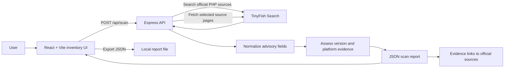

# PatchPilot AI

PatchPilot AI is a research-assisted security triage prototype. It accepts a
small software inventory, uses TinyFish Search and Fetch to locate official PHP
security advisories, compares advisory evidence with installed versions, and
returns a JSON report with evidence links and research notes.

## Problem

Security teams need to connect installed software versions to changing vendor
advisories. Manual research is slow, and a version-only match can be misleading
when an affected range, platform, build variant, or vendor backport is unknown.

## Proposed solution

PatchPilot combines a React inventory interface, an Express API, and a TinyFish
research workflow. The backend restricts research to a small set of official
PHP and PHP-source advisory URLs, normalizes returned advisory fields, and
assesses each advisory against the supplied inventory. Uncertain matches are
marked for review rather than treated as confirmed vulnerabilities.

## Features

- Add up to 20 software assets with product, version, operating system, and
  build type.
- Research PHP advisories from official PHP archive/release pages and
  `php/php-src` GitHub Security Advisories.
- Normalize CVE IDs, severity, affected/fixed versions, platform/build
  restrictions, remediation, and source URLs.
- Compare PHP versions within their release branch and return statuses such as
  `POTENTIALLY_AFFECTED`, `FIXED_FOR_THIS_CVE`, `NEEDS_REVIEW`, and
  `NOT_APPLICABLE`.
- Link to source evidence and show research notes.
- Export the scan report as JSON from the browser.

The current implementation is a PHP-focused proof of concept. It does not
provide a general vulnerability database or assert that an asset without a
match is secure.

## Architecture



See [docs/architecture.md](docs/architecture.md) and
[docs/api-contract.md](docs/api-contract.md) for implementation details.

## Technology stack

- Frontend: React 19, Vite
- Backend: Node.js, Express
- Research: TinyFish Search and Fetch API
- Tests: Node.js built-in test runner
- Styling: CSS

## Requirements

- Node.js and npm compatible with the package lockfiles
- A TinyFish API key for live research scans

## Installation

Install dependencies in each application directory:

```powershell
cd server
npm ci
cd ..\client
npm ci
```

## Environment variables

Create `server/.env` locally. Never commit this file or put real credentials in
documentation, screenshots, test fixtures, or exported examples.

```dotenv
TINYFISH_API_KEY=replace_with_your_own_key
PORT=5000
```

`PORT` is optional and defaults to `5000`. The frontend defaults to
`http://localhost:5000`; set `VITE_API_URL` in `client/.env` only if the backend
uses a different base URL:

```dotenv
VITE_API_URL=http://localhost:5000
```

Environment files are excluded by the repository ignore rules. The
`TINYFISH_API_KEY` is a backend-only secret and must not use a `VITE_` prefix.

## Run frontend and backend

Start the backend from one terminal:

```powershell
cd server
npm start
```

Start the frontend from another terminal:

```powershell
cd client
npm run dev
```

Open the local URL printed by Vite. Check backend readiness at
`http://localhost:5000/api/health`. A healthy response reports whether a
TinyFish key is configured; it does not verify that TinyFish is reachable or
that a scan will succeed.

## Example scan workflow

1. Add software assets or use the initial PHP sample assets (Web Server A,
   PHP 8.3.35, and Web Server B, PHP 8.3.36).
2. Select operating system and build type when known. Unknown values are
   intentionally retained as unknown.
3. Select **Run live investigation**. The backend searches official PHP
   advisory sources through TinyFish and compares returned evidence with each
   asset.
4. Review the CVE, assessment reason, platform conditions, research notes, and
   **Read source evidence** link for each finding.
5. Select **Export JSON** to download the report.

As of 2026-10-30, the official records for CVE-2026-109618 and
CVE-2026-109619 state that PHP 8.3 versions earlier than 8.3.36 are affected
and 8.3.36 is the fixed threshold for that release branch. The application's
scan output is research-driven and is not guaranteed to return these advisories
on every run. Consult [tests/verification-notes.md](tests/verification-notes.md)
for source and execution evidence.

## Limitations

- Only PHP advisory discovery and the current PHP-oriented assessment flow are
  implemented; other products are not supported as a general feature.
- A scan depends on the TinyFish key, service availability, search results,
  parsing, and current official source content.
- A status of `FIXED_FOR_KNOWN_CVES` means only that the version meets the
  threshold for advisories actually found and assessed. It is not a clean bill
  of health.
- Version comparison does not establish package provenance, distribution
  backports, custom build status, runtime configuration, exploitability, or
  complete platform applicability.
- Windows OS/build restrictions and required configuration conditions need
  evidence. Windows packages are not automatically equivalent to general PHP
  source releases.
- Reports are informational triage, not a substitute for vendor guidance or a
  security assessment.

See [docs/security-limitations.md](docs/security-limitations.md) for details.

## Future enhancements

- Add repeatable end-to-end tests with a safe, deterministic TinyFish API
  boundary and explicit test credentials.
- Expand advisory normalization to robustly represent multiple CVEs, version
  ranges, platform/build constraints, and configuration prerequisites.
- Add package-manager and vendor-backport evidence for distributions and
  Windows builds.
- Add authenticated inventory storage, scan history, report controls, and
  operational monitoring.
- Expand product coverage only after adding product-specific authoritative
  sources and assessment tests.

## Team contributions

This repository does not currently map work to named team members. The project
contribution areas are:

- Security research and official-source verification
- React inventory and results experience
- Express API and TinyFish integration
- Version assessment and test coverage
- Documentation and demo preparation

## Testing

Run the backend tests with `cd server; npm test` and build the frontend with
`cd client; npm run build`. The test dataset, execution outcomes, and
verification scope are documented in [tests/](tests/) and [docs/testing-strategy.md](docs/testing-strategy.md).
