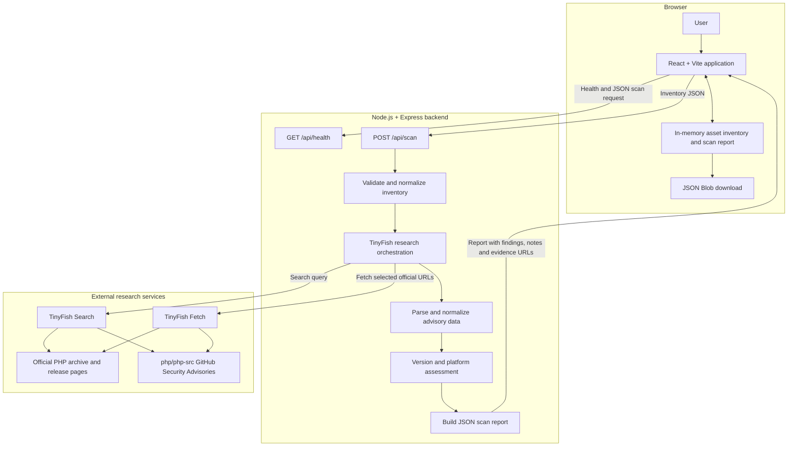

# Architecture

PatchPilot AI is a small browser-based PHP advisory research and triage
prototype. It has no database or inventory persistence layer: the inventory
and current report live in React state until the page is closed or the user
exports a report.

## Components and workflow

## Research and parsing

The frontend submits inventory to `POST /api/scan`. The Express backend
validates required fields and supported platform/build labels, then invokes
the PHP-oriented TinyFish workflow. The workflow sends two TinyFish Search
queries for official PHP/security advisory material and fetches a bounded,
deduplicated set of eligible pages. The accepted sources are PHP archive or
release URLs and PHP-source security advisory URLs on GitHub; arbitrary
third-party URLs are rejected by the source filter.

The research parser extracts CVE IDs, advisory title, severity, affected and
patched version text, platform/build restrictions, configuration conditions,
remediation, and the source page URL. Missing data is represented as unknown
rather than guessed. A source URL must be HTTPS and match the allowed source
patterns to be retained as evidence.

## Advisory normalization and assessment

`server/index.js` maps the research result into the API's normalized advisory
shape. For each inventory asset, the backend filters advisories by product and
calls the assessment helper. Assessment checks CVE identifiers, product
identity, platform/build constraints, affected-version evidence, fixed
version, HTTPS source, and parseable versions. Version comparisons are
restricted to the same major/minor release branch. Missing or mismatched
evidence leads to `NEEDS_REVIEW`; it does not become an affected/fixed guess.

The top-level finding summarizes its individual advisory outcomes. A fixed
status applies only to advisories returned and assessed in that scan. An empty
match set is not proof that no vulnerability exists.

## Report and evidence

The API response contains scan metadata, asset findings, advisory data,
research notes, and a disclaimer. The React UI renders the finding status,
assessment reason, platform conditions, notes, and a source link. The user can
serialize that response into a local JSON download. The backend does not save
reports.

## Security boundaries

- The TinyFish API key is read by the backend from its environment and is not
  sent to the browser.
- Research is limited to selected official PHP and PHP-source advisory
  sources.
- Scan results are triage evidence, not proof of exploitability, installed
  package identity, patch provenance, or comprehensive coverage.
- No authentication, persistent storage, user/tenant separation, or report
  access control is implemented in this prototype.
